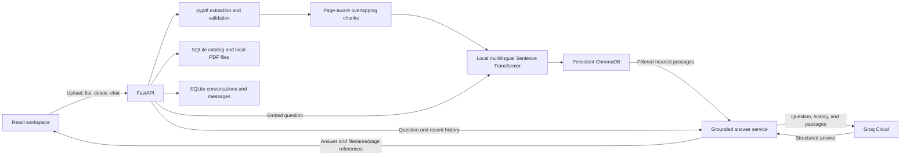
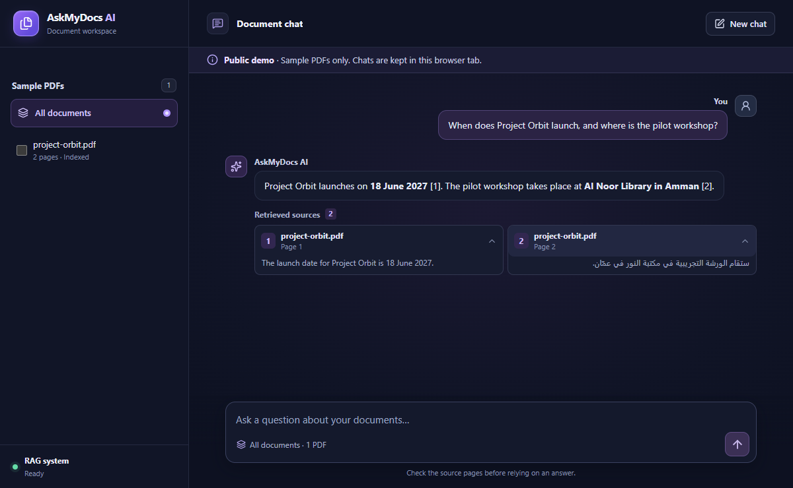

# AskMyDocs AI

AskMyDocs AI is a local document assistant for English and Arabic PDFs. Upload text-based files, choose which documents to search, and ask questions in a chat interface. Answers include numbered citations and excerpts tied to the original filename and page. The sidebar lets you reopen, rename, and delete saved conversations.

Version 1.0.0 also includes a read-only public mode for a personal portfolio demo. For setup on Render Free and Vercel Hobby, see the [free deployment guide](FREE_DEPLOYMENT.md).

Retrieval-augmented generation (RAG) gives a language model relevant evidence at the time you ask a question. AskMyDocs searches your local document index, then sends the selected passages to Groq for a grounded answer. Uploading a PDF indexes its text locally. It does not train or fine-tune the chat model.

## Architecture



In public mode, FastAPI loads two precomputed passage vectors for the bilingual Project Orbit sample. An ONNX Runtime encoder and SentencePiece tokenizer embed each question. The API ranks the passages, then uses the same Groq generation and citation checks as local mode. It serves the bundled corpus without opening the local document catalog, Chroma index, or conversation database.

| Layer | Libraries and services | Role |
| --- | --- | --- |
| Browser | React, TypeScript, Vite, Tailwind CSS, Lucide React | Chat and document controls, typed state and requests, development/build tooling, styling and icons |
| Rendering | react-markdown, remark-gfm | Render Markdown tables, lists, and emphasis with raw HTML and remote images disabled |
| API | Python 3.12, FastAPI, Uvicorn, Pydantic, python-multipart, python-dotenv | Run the local API, validate payloads, parse uploads, and load backend settings |
| Storage | pypdf, Python sqlite3 | Extract PDF text and store document metadata, conversations, and citation history |
| Retrieval | langchain-core, langchain-text-splitters, langchain-chroma, ChromaDB | Represent chunks, split pages, persist vectors, and apply document filters |
| Embeddings | Sentence Transformers, PyTorch | Run multilingual MiniLM on the local CPU and size chunks with its tokenizer |
| Public retrieval | ONNX Runtime, SentencePiece, NumPy | Encode questions on CPU and search the precomputed sample vectors |
| Generation | Groq Python SDK and GroqCloud | Request structured, cited answers from GPT-OSS |
| Tests | pytest, FastAPI TestClient, HTTPX | Exercise document handling, retrieval, routes, and SDK behavior with offline doubles |

## Set up on Windows

Install [Python 3.12](https://www.python.org/downloads/windows/) and [Node.js](https://nodejs.org/en/download) if needed. Vite requires Node.js 20.19+ in the 20.x series or 22.12+. Open the repository folder in VS Code and run the following from its root in PowerShell. [Vite requirements](https://vite.dev/guide/)

```powershell
py -3.12 --version
node --version
npm.cmd --version
py -3.12 -m venv .venv
.\.venv\Scripts\Activate.ps1
python -m pip install --upgrade pip
python -m pip install -r .\backend\requirements.txt
if (!(Test-Path .\backend\.env)) { Copy-Item .\backend\.env.example .\backend\.env }
if (!(Test-Path .\frontend\.env)) { Copy-Item .\frontend\.env.example .\frontend\.env }
npm.cmd --prefix .\frontend ci
```

Copy the example files only on initial setup so you keep your existing settings. If PowerShell blocks activation, use `Set-ExecutionPolicy -Scope Process -ExecutionPolicy Bypass` in that terminal or invoke `& .\.venv\Scripts\python.exe` in place of `python`. The virtual environment remains isolated when you use its interpreter directly. Use `npm.cmd` to avoid the PowerShell script wrapper.

Create an API key in GroqCloud, then set `GROQ_API_KEY` in `backend/.env` using VS Code or `notepad .\backend\.env`. Keep the key in the backend. You can start the app and index documents with the key blank. A question with relevant passages requires a configured key. [GroqCloud keys](https://console.groq.com/keys) · [Groq quickstart](https://console.groq.com/docs/quickstart)

### Run in two VS Code terminals

From the repository root, start the API in terminal 1.

```powershell
& .\.venv\Scripts\python.exe -m uvicorn app.main:app --app-dir .\backend --host 127.0.0.1 --port 8000 --reload --reload-dir .\backend\app
```

Start Vite in terminal 2.

```powershell
npm.cmd --prefix .\frontend run dev
```

Open [AskMyDocs AI](http://127.0.0.1:5173). See the [interactive API reference](http://127.0.0.1:8000/docs) or check the API from PowerShell.

```powershell
Invoke-RestMethod http://127.0.0.1:8000/api/health
```

The first upload downloads the multilingual embedding model from Hugging Face. Allow extra time and disk space for the download and CPU inference. Later uploads reuse the cached model. [Embedding model card](https://huggingface.co/sentence-transformers/paraphrase-multilingual-MiniLM-L12-v2)

## Configuration

The backend reads `backend/.env`. A process-level environment variable takes precedence. Relative storage paths resolve from the repository root. Restart the affected development server after changing an environment file.

| Variable | Default | Purpose |
| --- | --- | --- |
| `GROQ_API_KEY` | Blank | Secret required for generated answers |
| `GROQ_MODEL` | `openai/gpt-oss-20b` | Generation model. Also accepts `openai/gpt-oss-120b` |
| `GROQ_TIMEOUT_SECONDS` | `35` | Provider timeout, up to 120 seconds |
| `CHROMA_DIR` | `data/chroma` | Vector index |
| `UPLOAD_DIR` | `data/uploads` | Stored PDFs, named with generated IDs |
| `SQLITE_PATH` | `data/documents.sqlite3` | Document catalog |
| `CONVERSATIONS_PATH` | `data/conversations.sqlite3` | Saved conversations, messages, and citation snapshots |
| `MAX_UPLOAD_MB` | `10` | Per-file limit, configurable from 1 to 10 MiB |
| `EMBEDDING_MODEL` | `sentence-transformers/paraphrase-multilingual-MiniLM-L12-v2` | Local encoder for passages and questions |
| `RAG_TOP_K` | `4` | Maximum retrieved chunks, from 1 to 20 |
| `RAG_MIN_SIMILARITY` | `0.30` | Minimum cosine similarity for semantic matches. Strong exact-term matches can qualify independently |
| `RAG_DEBUG_CONTEXT` | `false` | Print the effective query, evaluated candidate ranks and scores, and the context prepared for Groq in the local backend terminal |
| `CHUNK_SIZE` | `800` | Maximum chunk length in characters, also bounded by the embedding model's token window |
| `CHUNK_OVERLAP` | `120` | Target character overlap, smaller than the chunk length |
| `VITE_API_URL` | `http://127.0.0.1:8000` | Public API origin in `frontend/.env` |

Both GPT-OSS models are listed in Groq's production catalog. The provider integration uses strict structured outputs. [Groq supported models](https://console.groq.com/docs/models) · [Groq structured outputs](https://console.groq.com/docs/structured-outputs) · [Official Groq SDK](https://github.com/groq/groq-python)

Local browser origins are configured in `backend/app/local.py` and default to `http://127.0.0.1:5173` and `http://localhost:5173`. For a public deployment, set `DEMO_MODE=true` and set `DEMO_ALLOWED_ORIGINS` on Render to the exact production Vercel origin. Set `VITE_API_URL` to the HTTPS Render origin before building the frontend. Vite exposes `VITE_*` values in the browser bundle.

## Local API

| Method and route | Input | Output |
| --- | --- | --- |
| `GET /api/health` | None | `status` and `groq_configured`. The boolean reports whether a key is set |
| `POST /api/documents/upload` | Multipart form with one or more `files` fields | `documents` and per-file `errors`. Each document includes its ID, filename, page count, chunk count, byte size, status, and creation time |
| `GET /api/documents` | None | `documents` with saved file metadata |
| `DELETE /api/documents/{document_id}` | Document ID | HTTP 204 after vectors, file, and record are removed |
| `GET /api/conversations` | None | A `conversations` list ordered by most recently updated |
| `POST /api/conversations` | Optional `document_ids` | HTTP 201 with the new conversation, selected documents, and an empty transcript |
| `GET /api/conversations/{conversation_id}` | Conversation UUID | The conversation and all its messages and citation snapshots |
| `PATCH /api/conversations/{conversation_id}` | A `title` of 1 to 80 characters | The renamed conversation summary |
| `DELETE /api/conversations/{conversation_id}` | Conversation UUID | HTTP 204 after the conversation and its messages are removed |
| `POST /api/chat` | `question`, `conversation_id`, and optional `document_ids` | `status`, `answer`, `sources`, the conversation summary and ID, and the two saved messages |

Chat accepts up to 2,000 characters per question and 100 selected document IDs. Omit `document_ids` to reuse the saved selection. Pass `null` to search all ready documents or an empty array to search none. The server reads up to eight recent messages from that conversation for follow-ups. Legacy requests without a conversation ID start a conversation on their first successful turn. The server ignores client-supplied history.

```powershell
$conversation = Invoke-RestMethod -Method Post -Uri 'http://127.0.0.1:8000/api/conversations' -ContentType 'application/json' -Body '{}'
$body = @{
    conversation_id = $conversation.id
    question = 'What is the launch date for Project Orbit?'
} | ConvertTo-Json
Invoke-RestMethod -Method Post -Uri 'http://127.0.0.1:8000/api/chat' -ContentType 'application/json' -Body $body
```

A batch upload with at least one success returns HTTP 200 and reports individual failures. Duplicate files return 409 when the entire batch contains duplicates. PDF validation errors use 400, 413, 415, or 422, and document-specific errors include a stable code and message. Unavailable dependencies and provider errors use safe 429, 502, 503, or 504 responses as appropriate. A question without sufficient evidence returns HTTP 200 with `status: "insufficient_context"`.

## Saved conversations

Choose **New chat**, ask a question, and look for the generated title in **Conversations**. Open an older conversation to resume it with its saved messages, citations, and available document selection. Rename or delete a conversation through its actions. Refresh the page to return to the browser's last active conversation.

SQLite stores conversation UUIDs, titles, creation and update timestamps, and the last document selection. Messages carry their own UUID, conversation UUID, role, content, creation timestamp, and an optional JSON citation snapshot. The app saves each successful question and reply together. Provider failures leave the transcript unchanged. Deleting a conversation removes its messages.

Deleting a PDF removes its index and excludes the file from new searches. Saved messages retain their citation snapshots, and the UI marks citations for deleted PDFs as historical. Earlier builds stored the current transcript in the browser tab's session storage. Saved history starts with this version. An earlier transcript can be copied from the original tab if its session storage is still available.

## Follow a PDF through the system

1. The API checks the filename extension, PDF signature, and file size. It hashes the PDF contents for deduplication and saves valid files under a generated ID.
2. pypdf extracts text page by page. The cleaner normalizes whitespace, keeps Unicode text, and pairs labels with values in recognizable metric cards. The splitter prefers line and paragraph boundaries, stays within the encoder's token window, and records the original filename, page number, document ID, and chunk ID.
3. The local model maps each passage to a vector of numbers representing its meaning. Chroma persists the vectors alongside the original passage and metadata. SQLite tracks the document and its status.
4. For specific questions, the same model creates a question vector. Search can omit a trailing instruction about how to present the answer. Chroma applies the chosen document IDs to both semantic and exact-term retrieval. The backend ranks eligible passages and returns up to four by default. If neither search finds a candidate, it skips Groq.
5. Groq receives the question, recent messages from the active conversation, and numbered passages. Conversation history helps resolve follow-up references. The prompt grounds claims in the passages and asks for verbatim quotes or an insufficient-context response.
6. The backend checks each quote against the supplied evidence and verifies numeric values against the quotes. If a quote was assigned to the wrong chunk, the app can correct it when the exact text identifies a single supplied page of that same document. It can verify addition or subtraction when the same claim quotes both operands and includes the equation. The response groups verified excerpts under one citation per document page. The `chunk_ids` list preserves the contributing chunk IDs, and `chunk_id` identifies the first.

Retrieval finds candidate evidence. Generation interprets it and writes the answer. The SQLite catalog makes completed documents selectable after a restart. If indexing or deletion is interrupted, the startup cleanup can finish removing partial records. Use one Uvicorn worker with this local storage design.

For English and Arabic summaries, overviews, and date lists, the backend scans the selected documents' existing chunks. Summaries use numbered evidence spans from the requested pages. A single bounded Groq request supplies candidate points. The backend selects verified points that cover the pages and the requested count when the evidence permits it. If it cannot verify a summary, it labels the fallback excerpts. Date answers pair the date, year, time or deadline with its printed source row. An explicit empty selection skips generation.

For supported duration comparisons, retrieval searches for the policy and measured event independently. Groq selects the evidence IDs and returns its verdict and margin. The backend checks the units and arithmetic against those exact sources before rendering the calculation with both citations. These paths read the existing index.

### Diagnose retrieval and refresh older indexes

For a local diagnostic session, set `RAG_DEBUG_CONTEXT=true` in `backend/.env` and restart Uvicorn at info level. Each `RAG request trace` has a UUID linking the retrieval candidates and the exact, credential-redacted evidence sent to Groq. It records the selected scope, strategy, pages, filtering decisions, request parameters, upstream HTTP status, finish reason, token usage and verification decision. For summaries, evidence IDs map back to the numbered input passages. Document-wide scans have no similarity cutoff.

Read `outcome` to distinguish empty retrieval, insufficient evidence reported by the model, provider failure, truncation, invalid structured output, rejected evidence and successful generation. A summary delivered as labeled source excerpts also records `delivery=labeled_excerpts` and the original failure. Debug output includes the question and document text. Enable it only for a development session and turn it off afterwards. The public demo disables this trace.

Groq generation errors log safe metadata even when context logging is off. The log includes the output limit, reasoning effort, response format, available token usage, and a failure category. It omits the key, document text, and provider error body. Use these logs to tell completion truncation apart from malformed JSON or upstream failures.

The citation fix works with the current index. Uploads created before token-aware chunking can be re-uploaded to apply the newer extraction and chunking. Start a new chat when checking a standalone question with empty history.

## Try the sample

Upload [Project Orbit](samples/project-orbit.pdf), a two-page fictional brief. The first page is in English and the second is in Arabic.

| Question | Expected evidence |
| --- | --- |
| What is the launch date for Project Orbit? | 18 June 2027, page 1 |
| أين ستقام الورشة التجريبية؟ | مكتبة النور في عمّان، الصفحة 2 |
| What is the pilot team's catering budget? | Insufficient context |

Upload the same file again to see the duplicate message. Select only Project Orbit and ask the launch-date question again. Reload the app or restart the backend and confirm the document still appears. Delete it to confirm it disappears from the library and future retrieval.

## Tests

Run these commands from the repository root.

```powershell
& .\.venv\Scripts\python.exe -m pytest .\backend
npm.cmd --prefix .\frontend run typecheck
npm.cmd --prefix .\frontend run build
```

The tests run without an API key or model download. They use deterministic embeddings with a real temporary Chroma index and test the Groq SDK with an HTTPX mock transport. The suite covers PDF validation and extraction, Arabic text, chunking, vector metadata, retrieval scope, deletion and recovery, prompt construction, and API errors. The manual sample checks the real model download and live provider account.

The browser tests exercise suggestion and typed-question submission against mocked APIs. With Microsoft Edge installed, run `$env:PLAYWRIGHT_CHANNEL='msedge'` followed by `npm.cmd --prefix .\frontend test`. You can also use Playwright's Chromium browser.

To include the optional demo memory check, prepare the separate demo interpreter and pinned model assets, then set `$env:ASKMYDOCS_DEMO_PYTHON = (Resolve-Path .\.venv-demo\Scripts\python.exe).Path` before running pytest. The same guide includes an offline retrieval evaluation for both languages. [Demo preflight](FREE_DEPLOYMENT.md#windows-preparation)

## Screenshots



The screenshot shows the running frontend with a simulated response from the synthetic Project Orbit brief.

## Public demo restrictions

Visitors can list the sample and ask questions about it. The API returns HTTP 403 for PDF uploads, document deletion, and saved-conversation routes. Each tab holds its own transcript in session storage. Questions, selected passages, and a bounded amount of the tab's recent history can reach Groq.

One worker enforces per-IP, global, daily, and concurrent chat limits. Counters reset when the process restarts. Requests over the limit receive HTTP 429 with a retry delay. CORS limits browser origins. Direct clients can still call the public API. [Deployment settings and optional Turnstile verification](FREE_DEPLOYMENT.md#environment-variables)

## Troubleshooting

| Symptom | What to check |
| --- | --- |
| `py -3.12` is unavailable | Install Python 3.12 with the Windows launcher, reopen VS Code, and check `py -0p`. If the launcher is absent, invoke the installed 3.12 interpreter by its full path |
| Activation is blocked | Run the process-scoped execution policy command above or use `.venv\Scripts\python.exe` directly |
| `npm` is blocked or Vite rejects Node | Use `npm.cmd` and verify the supported Node version. Reopen VS Code if the installer changed PATH |
| First upload fails while loading the model | Check access to Hugging Face and available disk space, then retry. To use a manually downloaded model, set `EMBEDDING_MODEL` to its local directory before creating the index |
| Existing index rejects a different embedding model | Restore the previous model path/name or configure fresh Chroma, SQLite, and upload paths together and re-upload the PDFs |
| PDF has no extractable text | Run OCR separately and upload the text-enabled copy. For encrypted files, upload an unlocked copy |
| Groq reports an authentication or model error | Verify the key and model in `backend/.env` and restart Uvicorn |
| Groq rate limit or timeout | Wait and retry, or check your account limits. Shorter questions, a smaller `RAG_TOP_K`, or a longer timeout may help with slow requests |
| API is unreachable in Vite | Check `/api/health`, `VITE_API_URL`, and the Vite origin/port |
| Follow-up misses the right page | Rephrase it as a standalone question. Retrieval embeds the current wording, while generation also sees recent messages |

## Limits, security, and privacy

- Local mode gives one trusted user access to all stored documents and conversations. Bind it to loopback. A shared private-document service would need authentication and per-user authorization.
- PDF files, text, vectors, and catalog records stay on your disk when indexing. When answering, the selected excerpts of your uploaded documents, their filenames, your question, and recent conversation are sent to Groq. Use documents you are authorized to share with that provider.
- The Groq key lives on the backend. Health reports whether it is configured. Git excludes private environment files, uploaded PDFs, and runtime data. The two environment examples and the synthetic Project Orbit PDF are intended for publication.
- Chat messages and source excerpts persist in local SQLite. Browser local storage keeps the last active conversation ID. Use the conversation's delete action to remove a saved transcript.
- PDF extraction depends on how the file encodes text. OCR is outside this MVP. Complex layouts, Arabic fonts, and tables can still produce incorrect reading order.
- The prompt separates PDF text from instructions. Quote and numeric checks catch some grounding errors. Compare the wording and meaning of important claims with the cited passages.

## Repository layout

```text
backend/
  app/
    api/          FastAPI routes
    core/         Environment settings
    demo_data/    Approved Project Orbit passages and precomputed vectors
    models/       Request and response types
    rag/          Splitting, embeddings, retrieval, prompts, and answers
    services/     PDF handling, document lifecycle, SQLite, and Groq
    main.py       Select the local or public app at startup
    local.py      Private workspace routes, CORS, and storage
    demo.py       Read-only public routes, CORS, and request limits
  scripts/        Prepare and verify the public retrieval assets
  tests/          Offline backend tests
  .env.example
  requirements.txt
  requirements-demo.txt
frontend/
  src/
    components/   Document and chat controls
    hooks/        Workspace and chat state
    pages/        Workspace
    services/     API client
    types/        API contracts
  .env.example
  package.json
data/             Local runtime storage, created as needed
samples/          Bilingual demonstration PDF
LEARNING_GUIDE.md
README.md
```

## Explain it in an interview

“I built a local RAG app that indexes PDFs page by page with a multilingual Sentence Transformer. FastAPI filters and searches persistent Chroma vectors by document ID. It sends only the retrieved passages with the question and recent conversation to Groq for a structured, cited answer. SQLite tracks document lifecycle, and the React app displays real page references so users can check the evidence. I tested ingestion and persistence with real Chroma and simulated the provider at the SDK's HTTP boundary.”

Discuss the tradeoff between chunk size and context specificity, or show how the model behaves as you adjust the similarity threshold. Measurable next steps include adding a bilingual evaluation set, improving follow-up retrieval with standalone query rewriting, supporting OCR with page provenance, and adding a reranker or keyword search for exact terms. See the [learning guide](LEARNING_GUIDE.md) for a walkthrough of the source.
